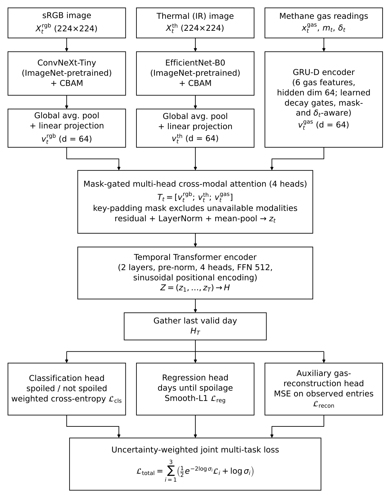

# Multimodal Fruit and Vegetable Degradation Modelling

**Spoilage detection from sRGB images, thermal images and methane readings, built to keep working
when a sensor drops out.**

[](LICENSE)


M.Tech thesis project (Phase I), Amrita School of Computing, Amrita Vishwa Vidyapeetham, Coimbatore.
Author: **Sri Janani S** · Guide: **Dr. Bagyammal T.**

Website: <https://srijanani2073.github.io/multimodal-fruit-spoilage-detection/> (source in [`docs/`](docs))

---

Spoiling produce changes colour, shifts in surface temperature and releases gas. This project fuses
all three signals from the six-produce **TR-6** dataset: CBAM-refined ConvNeXt-Tiny and
EfficientNet-B0 encoders read the sRGB and thermal images, a GRU-D network reads the irregular methane
readings, a **mask-gated cross-modal attention** layer excludes missing sensors instead of imputing
them, and a temporal Transformer follows each specimen day by day. One model predicts spoiled /
not spoiled and the days left until spoilage, with gas reconstruction as an auxiliary task.

<p align="center"></p>

## Results

On the held-out test set (11 trajectories), a 10-seed ensemble reached:

| F1 (spoiled) | AUC | Always-spoiled F1 | MAE (days) | Parameters |
|---|---|---|---|---|
| **0.80** [95 % CI 0.50, 1.00] | 0.73 | 0.71 | 0.92 | 32.5 M |

- **Sensor failure:** with up to 50 % of days missing one sensor, the model kept the highest absolute
  F1 in most single-sensor conditions; its advantage under gas-only and thermal-only dropout survives
  correction for multiple comparisons. Losing the sRGB camera hurts it the most.
- **What is not shown:** no single component could be statistically separated from simpler
  alternatives at this dataset size; only one of six held-out produce types was fully recognised in
  leave-one-fruit-out testing; the days-until-spoilage head is close to the mean predictor (R² 0.04).

Full tables, with the notebook behind each: [docs/guide/results.md](docs/guide/results.md).

## Quick start

```bash
git clone https://github.com/srijanani2073/multimodal-fruit-spoilage-detection.git
cd multimodal-fruit-spoilage-detection
python3 -m venv .venv && source .venv/bin/activate
pip install -r requirements.txt

# check the code without the dataset (a few minutes on CPU)
python scripts/check_setup.py --synthetic --no-pretrained

# with TR-6 downloaded (see INSTALL.md)
export TR6_ROOT=/path/to/TR-6
python scripts/check_setup.py                      # expects 12 / 12 / 11 trajectories
python scripts/train.py --variant full --seeds 0-9
python scripts/evaluate.py --variant full
python scripts/robustness.py --variant full
```

Everything, including the six ablation variants and the significance tests:
`bash scripts/reproduce_all.sh`. Details: [INSTALL.md](INSTALL.md) and
[scripts/README.md](scripts/README.md).

## Repository layout

```
.
├── Code/                       research notebooks 01–14 (the original record, unchanged)
│   └── Manifest/manifests/     master_manifest.csv (the split) and splits_info.json
├── src/trimodal/               reusable package behind the scripts
│   ├── config.py               paths, hyperparameters, model variants
│   ├── data.py                 manifest → day-level trajectories → padded batches
│   ├── model.py                encoders, GRU-D, fusion, temporal model, all variants
│   ├── training.py             multi-task loss, training loop, threshold calibration
│   ├── evaluation.py           seed ensemble, k-fold median threshold, test metrics
│   ├── robustness.py           missing-modality sweep
│   └── stats.py                bootstrap CIs, paired bootstrap, Benjamini–Hochberg
├── scripts/                    check_setup, train, evaluate, robustness, compare, reproduce_all
├── tests/                      smoke tests on a generated stand-in for TR-6
├── runs/                       outputs of every notebook (histories, CSVs, figures; no weights)
├── docs/                       project website (GitHub Pages)
│   └── guide/                  notebooks, data pipeline, model, results
├── INSTALL.md                  installation and dataset setup
├── requirements.txt            core dependencies (+ requirements-notebooks.txt)
├── pyproject.toml              `pip install -e .`
└── CITATION.cff · LICENSE · CHANGELOG.md
```

## Two ways to reproduce

**Notebooks** ([guide](docs/guide/notebooks.md)). Run `Code/01` … `Code/14` in order. Each notebook
is self-contained and writes to its own folder in `runs/`. This is exactly how the thesis results
were produced.

**Scripts** ([guide](scripts/README.md)). The same pipeline as command-line programs on one shared
package, with no notebook state. The model code loads the notebooks' checkpoints unchanged (the tests
verify that every variant's parameters match), so notebook runs can be re-evaluated from the command
line.

## Dataset

TR-6 is not included here. Six produce types (banana, carrot, guava, Indian gooseberry, mango, tomato),
one not-spoiled and one spoiled specimen each, recorded up to three times a day with an sRGB camera, a
thermal camera and methane sensors: 112 day entries in 12 trajectories, split by day 73 / 21 / 18.
Because the split is by day, the main test measures generalisation over time within partly seen
specimens; leave-one-fruit-out (notebook 09) tests unseen produce types.

> D. Unnikrishnan, K. Deepak, Y. A. P T S and B. T, "Multimodal perishable fruits and vegetables
> dataset," *Data in Brief*, 2026. [doi:10.1016/j.dib.2026.112545](https://doi.org/10.1016/j.dib.2026.112545) ·
> files: [doi:10.6084/m9.figshare.30783827](https://doi.org/10.6084/m9.figshare.30783827)

More: [docs/guide/data.md](docs/guide/data.md).

## Citation

```bibtex
@mastersthesis{srijanani2026trimodal,
  author = {Sri Janani S},
  title  = {Multimodal Fruit and Vegetable Degradation Modelling via Heterogeneous Sensory Fusion},
  school = {Amrita Vishwa Vidyapeetham, Amrita School of Computing, Coimbatore},
  type   = {M.Tech dissertation (Phase I)},
  year   = {2026}
}
```

Please also cite the TR-6 dataset above. Code released under the [MIT licence](LICENSE); the dataset
has its own terms.
