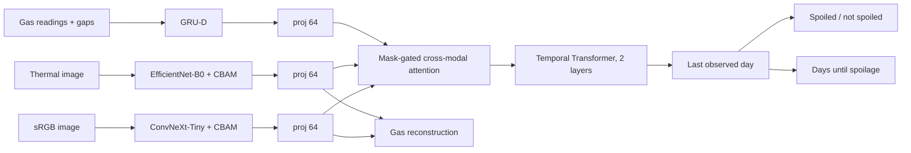

# Model and training

Code: [`src/trimodal/model.py`](../../src/trimodal/model.py) and
[`src/trimodal/training.py`](../../src/trimodal/training.py).

## Architecture

| Block | Detail |
|---|---|
| Visual encoders | ImageNet-pretrained `features` of ConvNeXt-Tiny (768 channels) and EfficientNet-B0 (1280), CBAM (reduction 16, 7×7 spatial kernel), global average pool. Frozen at first, then unfrozen gradually. |
| Gas encoder | GRU-D, input 6, hidden 64. Between readings the last value decays towards the mean and the hidden state decays, both at learned rates driven by the gap in days. |
| Projections | Linear → LayerNorm → ReLU → Dropout to d = 64, multiplied by the availability mask. |
| Fusion | 4-head self-attention over the three modality tokens of each day. Missing modalities are excluded from the keys and from the average; a day with nothing observed attends over all three. |
| Temporal | Pre-norm Transformer encoder, 2 layers, 4 heads, FFN 512, sinusoidal positions; the output at the last observed day is used. |
| Heads | Classification and regression MLPs (64 → 128 → 2 / 1, the regression head ends in ReLU); gas reconstruction from the last day's sRGB and thermal embeddings (128 → 6). |
| Loss | Weighted cross-entropy + Smooth L1 on days-until-spoilage + MSE on reconstructed gas (only where gas exists), combined with learned uncertainty weights: Σ ½·e^(−2 log σᵢ)·Lᵢ + log σᵢ. |
| Size | 32.47 M parameters, 39.03 GFLOPs per batch. |

## Variants

All built by `TrimodalModel(variant)`; definitions in `config.VARIANTS`.

| Variant | Change from `full` |
|---|---|
| `full` | — |
| `no_cbam` | CBAM removed from both visual encoders |
| `no_cross_attn` | Per-day fusion by concatenation + projection instead of attention |
| `lstm` | One-layer LSTM instead of the temporal Transformer |
| `mean_impute` | Missing gas set to zero (the mean) and a plain GRU over [reading, mask] instead of GRU-D |
| `early_fusion` | Embeddings concatenated per day, LSTM, mean imputation, no CBAM |
| `late_fusion` | One LSTM and head per modality; logits averaged over the modalities seen on the last day; mean imputation, no CBAM |

## Training recipe

| Setting | Value |
|---|---|
| Optimiser | AdamW, weight decay 1e-4 |
| Learning rate | 1e-4; thermal backbone 1e-5 (both backbones with `--ablation-recipe`) |
| Schedule | Cosine annealing over 30 epochs |
| Batch size | 4 trajectories |
| Gradient clipping | Max norm 1.0 |
| Unfreezing | Last backbone block at epoch 6, last two at 8, all at 12 |
| Model selection | Epoch with the best validation F1 |
| Threshold during training | Re-calibrated on the training set every epoch, applied to validation |
| Seeds | 0–9, ensembled by averaging P(spoiled) |

## Decision threshold

On a test set of 11 trajectories the threshold moves F1 a lot, so it is chosen without looking at
test data and in a way that resists a few borderline cases: the averaged ensemble predicts the 24
train + validation trajectories, these are split into K stratified folds (K = smaller class count,
capped at 6), the F1-optimal threshold is found on each fold's training part (grid 0.10–0.90), and the
**median** of the K thresholds is used. For the reported model this is 0.660.
